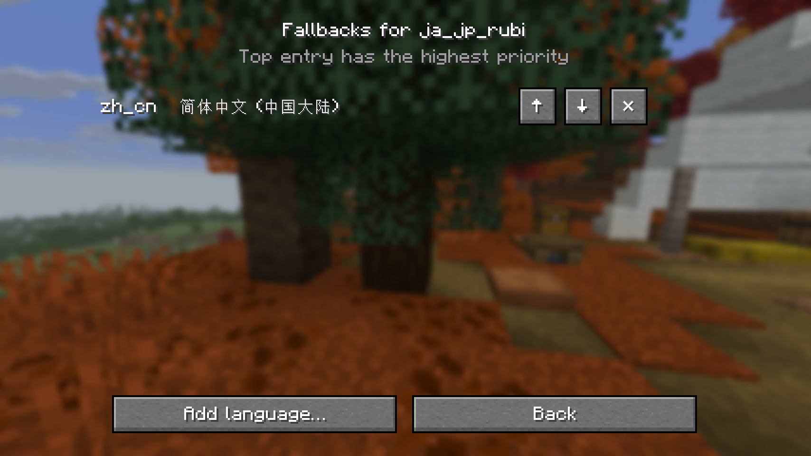
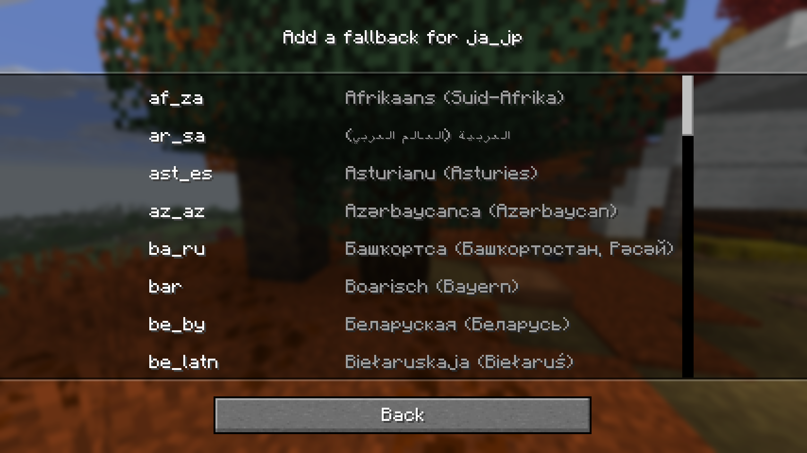

# secondlang 1.0.0+26.3

[](https://github.com/deepseek-ai/deepseek-harness)

First public release. A client-side Fabric mod for Minecraft **26.3** that replaces the single
hard-coded fallback to English with a configurable chain of languages for each selected
language.

## Why this exists

Minecraft only ever loads two languages: `en_us` and the one picked in **Options → Language**.
Every key missing from the selected language therefore drops straight to English — even when a
perfectly good translation exists in a third language, or in the base language that a custom
variant such as `ja_jp_rubi` is derived from. secondlang lets you say "for this language, try
these others first" and merges them below the selected language, so a home-made language or a
third language no longer disappears into English on the first missing key.

## How it works

One mixin, one point of interception: `@WrapOperation` on
`ClientLanguage.loadFrom(ResourceManager, List<String>, boolean)` inside
`LanguageManager.onResourceManagerReload` rewrites the language stack before vanilla builds its
lookup maps. No reflection, no resource-pack edits, no packet is ever sent to a server.

## Configuration

The file lives at `<game directory>/config/secondlang.json` and is created on first launch:

```json
{
  "chains": {
    "ja_jp_rubi": ["ja_jp"]
  }
}
```

* The key is the language **code** you select in Options → Language (for example
  `ja_jp_rubi`), not its display name.
* The value lists fallback languages, **highest priority first**.
* Do not list the selected language itself, and do not list `en_us`: English is always the base
  layer and is appended automatically.
* Deleting the file, or leaving `chains` empty, restores vanilla behaviour.
* The file is plain JSON and can be edited by hand; restart the game or press **F3+T** to reload
  resource packs afterwards.

## The in-game screen

With Mod Menu installed: **Mod Menu → secondlang → Configure**.

1. The language list shows every language the game knows together with its current chain
   (`—` when none). Select a row and choose **Edit chain…**.
2. The editor shows the chain with the highest priority on top, **↑ / ↓ / ✕** on every row, and
   **Add language…** to open a picker of the remaining languages.
3. Picking a language appends it to the chain; **Back** returns without saving anything further.

Saving a chain reloads resource packs immediately, so no restart is needed.



## Playing nicely with ruppi

[ruppi](https://github.com/Shiro-Design-16/ruppi) is a Japanese ruby-text mod. When the selected
language ends in `_rubi`, ruppi inserts the base language (for example `ja_jp`) directly above
English so that packs shipping only the base language still apply. secondlang never removes what
another mod put into the stack:

* ruppi's base language always stays **above English**.
* secondlang's configured chain sits **above ruppi's base language**, so an explicit fallback
  still wins over the automatic one.
* When ruppi is installed and you edit a `_rubi` language, the chain editor shows a read-only
  reminder naming the language ruppi adds. It is informational only — ruppi's settings are never
  read or modified.


## Requirements

* Minecraft **26.3** with Fabric Loader **0.20.1** or newer, Java 25.
* **Fabric API** — required.
* **Mod Menu** — optional; without it you edit `config/secondlang.json` by hand and the game
  behaves identically.

## Assets

* `secondlang-1.0.0+26.3.jar` — the mod itself (about 40 KB, client-side only). This is the file
  to drop into your `mods` folder.
* No resource pack is shipped, and none is needed: the mod only changes which installed packs are
  consulted for a language.
* The build also produces `secondlang-1.0.0+26.3-sources.jar`; it is intentionally not attached
  to this release.



## Licence and credits

GPL-3.0; see `LICENSE`. The project skeleton came from ruppi's Fabric template, and the
wrap-operation approach to `ClientLanguage.loadFrom` follows ruppi's implementation.

---

## 简体中文摘要

**用途**：给每个语言配置一条「回退链」。Minecraft 原版只会加载 en_us 与你在「选项 → 语言」里
选中的那一个语言，缺键就直接掉到英文；自造语言（如 ja_jp_rubi）或第三语言里明明有译文的键，
也会被英文顶掉。secondlang 让你声明「这个语言缺键时先试这些」，把整条链插在所选语言之下、
英文之上。

**机制**：一个 mixin，用 @WrapOperation 重写 ClientLanguage.loadFrom 收到的语言栈，之后原版
照常构建查找表；不改资源包、不反射、不发任何网络包，纯客户端。

**配置**：游戏目录下的 config/secondlang.json，首次启动自动生成，示例即
{"chains": {"ja_jp_rubi": ["ja_jp"]}}。键是语言代码，值按优先级从高到低排列；英文始终是自动
追加的最底层，不要手写 en_us。删掉文件或清空 chains 即回到原版行为；改完按 **F3+T** 重载资源包。

**游戏内界面**：装了 Mod Menu 时走 **Mod Menu → secondlang → Configure**：语言列表 →「Edit
chain…」→ 用 ↑ / ↓ / ✕ 调整顺序、用「Add language…」从剩余语言里挑一个追加；保存后立刻重载
资源包。没装 Mod Menu 就手改 JSON，效果完全一致。

**与 ruppi 的兼容**：ruppi 在 _rubi 语言下会把基语言（如 ja_jp）插在英文正上方；secondlang
从不删除别的 mod 放进栈里的内容——ruppi 的基语言保留在英文之上，secondlang 配置的链再压在它
之上，因此显式配置的回退仍然优先。编辑 _rubi 语言时界面会显示一行只读提示，告诉你 ruppi 加了
哪个语言；该提示仅供参考，绝不读取或修改 ruppi 的设置。

**依赖**：Fabric API 必需；Mod Menu 可选（只影响是否有图形配置界面）。Minecraft 26.3 / Fabric
Loader 0.20.1+ / Java 25。

**资产**：secondlang-1.0.0+26.3.jar（约 40 KB）即 mod 本体，丢进 mods 文件夹即可。本仓库不含
资源包，也不需要资源包。
